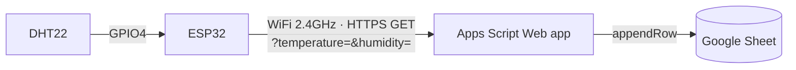

# ESP32 + DHT22 → Google Sheets

เครื่องบันทึกอุณหภูมิและความชื้นอัตโนมัติ: ESP32 อ่านค่าจากเซนเซอร์ DHT22 แล้วส่งขึ้น Google Sheet ผ่าน Google Apps Script ทุก 4 ชั่วโมง

## การทำงาน

- เปิดเครื่องแล้วส่งค่าทันที 1 ครั้ง จากนั้นส่งทุก 4 ชั่วโมง
- อ่านเซนเซอร์ไม่ได้ หรือ WiFi หลุด → ลองใหม่ทุก 10 วินาทีจนส่งสำเร็จ
- แต่ละแถวในชีต: เวลา · อุณหภูมิ (°C) · ความชื้น (%)

## อุปกรณ์และการต่อสาย

| DHT22 | ESP32 |
| --- | --- |
| VCC | 3V3 |
| GND | GND |
| DATA | GPIO4 |

เซนเซอร์แบบเปล่า (ไม่ใช่โมดูล) ต้องต่อตัวต้านทาน 10kΩ จาก DATA ไป 3V3 · ห้ามใช้ขา 34/35/36/39 เพราะเป็นขารับเข้าอย่างเดียว

### 🛒 ซื้ออุปกรณ์

| อุปกรณ์ | ซื้อได้ที่ |
| --- | --- |
| ESP32 (WiFi, USB Type-C) | [Globalbyte — ESP32 WiFi USB Type-C Board](https://globalbyteshop.com/products/esp32-wifi-usb-type-c-board) |
| DHT22 (AM2302) | [Globalbyte — DHT22 AM2302 Temperature and Humidity Sensor](https://globalbyteshop.com/products/dht22-am2302-temperature-and-humidity-sensor) |

## ติดตั้ง

1. **Google Sheet + Apps Script**
   - สร้างโปรเจกต์ Apps Script แล้ววางโค้ดจาก [`apps-script/Code.gs`](apps-script/Code.gs) แก้ `SPREADSHEET_ID` เป็น ID ของชีต
   - Deploy → การทำให้ใช้งานได้รายการใหม่ → เว็บแอป · เรียกใช้ในฐานะ: ฉัน · ผู้มีสิทธิ์เข้าถึง: ทุกคน
   - ก๊อป URL ที่ลงท้ายด้วย `/exec` · ทดสอบโดยเปิด `<URL>?temperature=25&humidity=60` ในเบราว์เซอร์ ต้องขึ้น `OK: ...` และมีแถวใหม่ในชีต
2. **ESP32**
   - Arduino IDE: ติดตั้งบอร์ด ESP32 และไลบรารี "DHT sensor library" (Adafruit)
   - ก๊อป `esp32_dht22_gsheet/secrets.example.h` เป็น `secrets.h` แล้วใส่ชื่อ WiFi รหัส และ URL `/exec`
   - เลือกบอร์ด `ESP32 Dev Module` แล้ว Upload (ถ้าค้างที่ `Connecting...` ให้กดปุ่ม BOOT ค้างไว้)
   - Serial Monitor 115200 ควรเห็น `HTTP 200 OK: Temp=...`

## หมายเหตุ

- `secrets.h` ไม่ถูก commit (อยู่ใน `.gitignore`) · ห้ามใส่รหัส WiFi หรือ URL `/exec` ลง repo เพราะใครมี URL ก็เขียนลงชีตได้
- ESP32 ต่อได้เฉพาะ WiFi 2.4GHz
- Apps Script มีโควตาต่อวัน ส่งทุก 4 ชั่วโมงปลอดภัย
- แก้ `Code.gs` แล้วต้อง Deploy เวอร์ชันใหม่ ไม่งั้นเว็บแอปยังรันโค้ดเก่า
